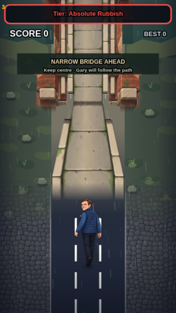
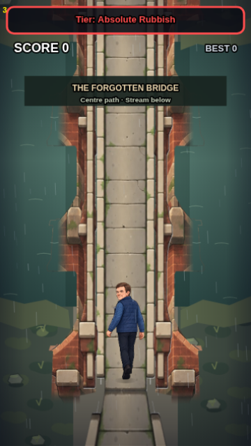
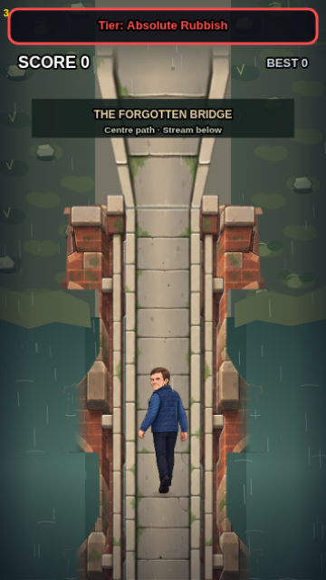
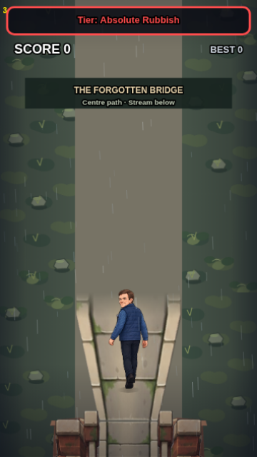

# Forgotten Bridge — supplied artwork review candidate

**20 October 2026 · CODE-OBSERVED on PR #5, stacked on unmerged PR #4. Artwork and raised architecture remain NOT APPROVED.** Normal Play keeps PR #4's procedural bridge. This integration is available in the actual game engine through the isolated Camera Lab session; it is not deployed to main/Pages or promoted as final production art.

## Review in Camera Lab

Serve the checkout (`python3 -m http.server 8000`), open `gary-camera-lab.html`, then select **Review supplied bridge artwork**. Use Approach / Enter / Middle / Exit and **Play preview** to cross continuously into wilderness. **Freeze frame** pauses presentation. Untick the two guide checkboxes for a clean engine view. **Compare geometry templates** retains the earlier v2 blockout as a comparison; unticking registered artwork returns to the legacy bridge. The source artwork is registered, not deformed by sliders: height/projection controls are disabled for the painted candidate.

This is the existing `index.html` → `gary-difficulty-runtime.js` engine, not a standalone illustrated mock-up. Candidate selection requires `debug=1&bridgepreview=1`; ordinary debug and normal gameplay reject candidate activation. Preview saves remain isolated. No physics, lane, scoring, narrative, audio, fixed-timestep or collapse policy changed.

## Actual 360×640 engine captures

| Approaching, near210 | Entering, near560 | Halfway, near850 | Exiting, near1210 |
| --- | --- | --- | --- |
|  |  |  |  |

These four captures were exported from the active Chromium engine canvas and opened for visual inspection. They are **review evidence, not visual approval**. The original PR #4 views remain in `docs/bridge/`; v2 blockout captures remain in `docs/bridge-art/`. WebKit independently produces the same four views and moving waterline samples under ignored `test-results/bridge-review-webkit/`.

## Registration and geometry

The supplied ZIP's three `production/*.png` files are installed unchanged under `art/bridge/production/`. Their SHA-256 hashes match the delivery report in `supplied-qc.json`; `SUPPLIED_README.txt` is preserved as provenance, including its pre-integration warnings. No painted pixels were generated, redrawn, cleaned, recoloured, cropped or rescaled in the source files.

- Each source is **720×2000 RGBA**, source anchor **(360,1600)**, runtime draw **360×1000** at **(0,bridgeNear−800)**. The design anchor remains **(180,bridgeNear)**.
- Canvas **360×640**; road **x105..255 / 150 units**; walking deck **x138..222 / 84 units**, length **620**. The existing centre guidance, lane lock and return to three lanes remain authoritative.
- `gary-bridge-art-review.json` is the separate **unapproved** supplied-art pack. The old `gary-bridge-art-contract.json` and `art/bridge/templates/` remain unchanged as the v2 blockout comparison. They do not clip the new artwork.
- The broader rounded lower masonry is registered by a deterministic row-band trace of its actual nonzero alpha. The same method registers deck/parapets. Source trace bands are lossless geometry, not a second illustration. A conservative two-source-pixel containment guard prevents antialiased outlines from being cut off or alpha-multiplied during cache composition. Tests compare the composited painting with a single original-image draw, pixel for pixel.
- Calibrated opening longitudinal envelopes are approximately **y270..374,450..554,630..734**; heavier support envelopes **y175..270,374..450,554..630,734..819**. Actual rounded boundaries are owned by the traced alpha, not the old affine v2 arch equation. The measured masks and guides follow this candidate. Historical height80/projection.8 fields remain a provisional comparison profile, not a claim that these PNGs were mathematically generated at that projection.
- Both untrimmed paving canvas boundaries feather over **36 design units** into the existing road. This cached compositing transition changes neither the central deck nor the source painting. The rest of the rendered artwork is unclipped. The supplied asymmetric approach taper is retained for review.

### Exact render order

1. Existing terrain, stream and independent bank contours.
2. Painted lower masonry, connected spans and supports.
3. Independent water mask over the outer submerged foundations.
4. Painted stone deck.
5. Existing Gary, food and gameplay objects.
6. Painted foreground parapets.
7. Existing rain, vignettes, HUD and captions.

Water is never in a structural PNG. The separate mask follows the new outer foundations, uses the existing stream colours/central shadow, and intersects structural alpha so it cannot fill an opening. The interior supports have contact ripples at local **(78/282,408/588)**. The mask remains entirely outside x138..222. Existing bank contours replace the v2 diagnostic rectangular bank strips; grass, rocks and vegetation stay in the environment provider. Nine-position native checks and continuous browser samples exercise registration as the bridge scrolls. Centre-deck roast visibility is checked before pickup; the existing actor/item ordering remains unchanged.

## Reproduce and validate

`node tools/export-bridge-review.cjs` deterministically traces **alpha only**, exports `gary-bridge-art-review.json`, three containment templates and the independent water mask under `art/bridge/review-masks/`, and writes its measured hash/alpha/bounds report. It does not write the supplied production PNGs. `node tools/export-bridge-templates.cjs` still reproduces the original v2 comparison masks. All new PNGs, masks and four committed screenshots are registered in `asset-quality-manifest.json`.

Run `npm test` for unit/controller, all registered assets, native/active-runtime integration and Chromium checks. Run `GARY_TEST_ENGINE=webkit npm run test:browser` for all four existing browser suites in WebKit. `tests/bridge-art.test.cjs` also verifies original-delivery hashes, exact painting containment, genuine holes/connected masonry, separate water, deterministic exports, bounded cache allocation, atomic review activation, roast pickup, pause/reset, saves and safe completion. `tests/bridge-art-browser.cjs` exercises both the earlier blockout and supplied candidate, exports all four views, checks food visibility, plays the entire approach-to-wilderness sequence and records timing/allocation diagnostics. No automated artistic or physical-device approval is implied.

## Performance and review findings

The candidate precomposes five **360×1000** caches once on selection: **7,200,000 bytes / 6.87 MiB**, versus 27.47 MiB for five 720×2000 blockout caches. The three original decoded sources cost approximately **16.48 MiB**; combined candidate sources/caches are approximately **23.35 MiB**, excluding browser/GPU duplication, legacy environment caches (about 5.49 MiB), and other game resources. These are RGBA storage estimates, not measured phone resident memory. The logical draw scale remains 360×1000; the review caches use design resolution, so physical high-DPI sharpness still needs inspection.

Preset changes reuse prepared artwork rather than rebuilding five canvases. There is no artwork decode, tracing, image readback, pixel processing or canvas allocation in gameplay frames. Eight small existing street crop caches warmed during the early moving approach in the measured run; they are not artwork caches. Once the existing terrain covers the entire viewport (near≥500), the engine now skips the hidden street/shops/lighting passes underneath it. No gameplay update is skipped. This removes meaningful overdraw and late hidden cobble-cache work.

See [QA results](docs/bridge-review/QA.md) and the committed Chromium/WebKit crossing and comparison reports for measured host timing and limitations.

### Significant artwork review issues / ChatGPT handoff

The delivery has pale extraction fringe/speck pixels along parts of the lower arch cut-outs and parapet/post silhouettes; small flat brown cutout/patch shapes are also present around some support edges. These are visible in the original source on contrasting backgrounds and faintly in engine views. The engine adds no white background, checkerboard, dark extraction halo or opaque source rectangle. **Final edge cleanup belongs to the source artist/ChatGPT**, retaining registration and the original painting; Codex has deliberately not repainted or eroded the approved outlines to hide it.

The deck's taper paving was an inferred continuation in the delivery and still needs approval. The engine boundary feather removes its hard canvas join, but does not make the inferred paving or raised masonry camera approved. The existing wilderness terrain remains procedural and simpler than the supplied bridge; full wilderness art/encounters are outside this task. No new illustration was made.

Final acceptance requires human visual approval of the supplied masonry, parapets, inferred approach paving, water contact and raised-architecture perspective, followed by physical iPhone Safari checks of first load, sharpness, scrolling/frame pacing, memory, pause/resume and export/share. These are **UNVERIFIED-ON-DEVICE**. Collapse stays disabled because the underwater/cave destination has not shipped. PR #4 and PR #5 require explicit merge approval; neither is merged by this work.

## External PNG delivery — engineering handoff

The original three-layer delivery has now been imported and reviewed as a candidate, superseding the previous "not supplied" handoff. Any corrected artwork must retain the same full canvases, anchors, alpha backgrounds, source paths and walking deck. Re-run the alpha exporter, full tests, captures and visual review after replacement. Normal Play must not activate it automatically. A future final-art promotion needs explicit visual approval and a separately reviewed activation change.
