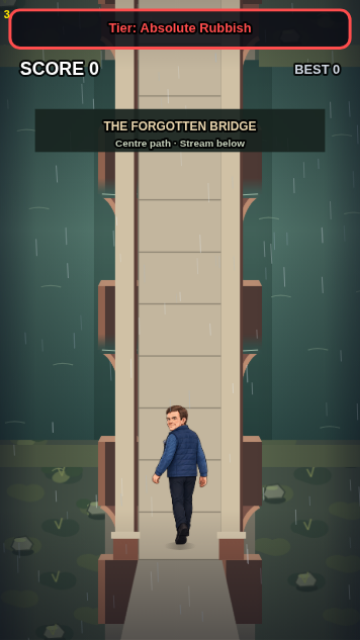
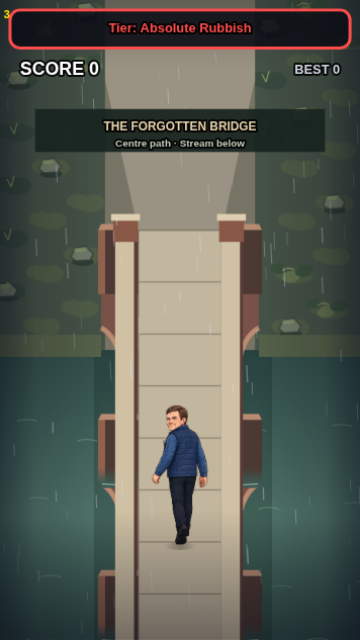
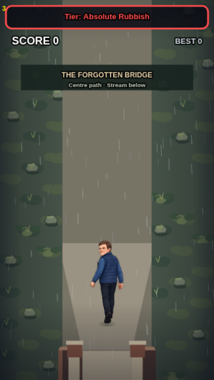

# Forgotten Bridge — registered artwork handoff

**Technical preparation only. Projection and art are NOT APPROVED.** PR #5 remains stacked on bridge PR #4. Neither main nor either PR is merged by this work. The attached JPEG informs only reddish masonry, pale caps, broad slabs and repeated exterior arches. It is not imported, cut out or used as a camera reference. No material artwork has been generated.

## Review in Camera Lab

Serve this checkout (`python3 -m http.server 8000`) and open `gary-camera-lab.html` (use the computer's LAN address on iPhone). Select **Real game**, then **Registered artwork blockout** or **Test registered PNG layers**. The latter decodes the three actual template files, validates their dimensions and composes them through the same replacement masks. Entry/Middle/Exit, play/freeze, guides, support height, parapet height, height projection and candidate JSON export all use the existing engine. Sliders update preview geometry only; the published camera contract stays provisional and unchanged. Slider input is debounced to avoid rebuilding caches every animation frame.

Normal Play and the original bridge preview keep the existing PR #4 renderer. Candidate artwork is accepted only in the isolated `debug=1&bridgepreview=1` session. A failed pack leaves the previous renderer intact. A switch back to the legacy renderer is immediate. There is no change to the 60 Hz update loop, encounters, centre guidance, score, collisions, saves, lane centres or collapse gate.

### Actual 360×640 candidate captures

These were generated through Camera Lab's **real-engine** iframe, not the geometry overlay or a standalone scene. Opened and inspected: entry shows the near supports descending beneath the deck; middle shows repeated recesses, deep piers and submerged bases; exit shows Gary on the widening path and the remaining end supports. Flat colours and hard edges deliberately identify a geometric blockout. The existing captures in `docs/bridge/` are the before comparison.

| Entry, near=560 | Middle, near=850 | Exit, near=1210 |
| --- | --- | --- |
|  |  |  |

[Exported Camera Lab candidate](docs/bridge-art/camera-candidate.json) · [Authoring pack](gary-bridge-art-contract.json) · [Actual alpha/bounds/hash report](art/bridge/templates/registration-report.json)

The initial **candidate**, not a recommendation for approval, uses the existing provisional height factor 0.80, an 80-unit support descent (64 screen units), and a 14-unit parapet height (11.2 screen units). Deck and actors remain on the original screen plane. Raising Gary or changing collision/world geometry is outside this calibration. Review the side-face convention, entrance/exit massing, arch rhythm and waterline in motion before locking any silhouette. The angular banks, simple slab outlines, end fascia and caps are diagnostic geometry rather than art acceptance.

## Exact artist specification

All three structural files are **720×2000 RGBA PNG**, one untrimmed cell, 2 source pixels per design unit, true transparent background. Each draws at **360×1000 design units**, at **x=0, y=bridgeNear−800**. Common source anchor **(360,1600)** maps to design anchor **(180,bridgeNear)**. Far deck edge: source y360 / design y180; near deck edge: source y1600 / design y800. Do not trim, rescale individual layers, rotate, change the camera, or move this anchor. Main gameplay remains 360×640, deck x138..222 (84), bridge length620; approaches x105..255 (150), lanes130/180/230.

| Order | Pass / source | Exact destination and anchor | Content and exclusions |
| --- | --- | --- | --- |
| 1 | Terrain/stream/banks — existing engine environment and independent blockout bank cache | Existing world distance; all local bridge masks use the common anchor above | Water, vegetation, rocks, ground and bank shapes belong ONLY here. The normal legacy environment stays separate. |
| 2 | [lower.png](art/bridge/templates/lower.png) | 360×1000 at (0,near−800); source anchor (360,1600) | Structural sides x101..138 and222..259. Recesses cut alpha out of the silhouette, piers at local y180/370/526/682/800 extend down64 in this candidate. Piers x98..141 and219..262; near fascia x138..222 y800..864. Flat warm/dark face values are guides; artist supplies brick, soffits, wear and shadows within the approved silhouette. |
| 2b | [water-occlusion-mask.png](art/bridge/templates/water-occlusion-mask.png) — ENVIRONMENT ONLY | Same 720×2000 source / 360×1000 draw and anchor | Overlaps the lower 16 units of submerged feet at local y434 and590, with 4-unit overflow. X98..141 /219..262. Stream-colour alpha fade plus bounded contact ripples embeds supports. Never include this water in the masonry image. |
| 3 | [deck.png](art/bridge/templates/deck.png) | Same registration | x138..222 y180..800; broad 52-unit slab guide intervals. 150-unit-long taper at each end returns to x105..255. The untrimmed source extends through the approach/exit to y0/1000. Paving only, no characters, water or vegetation. |
| 4 | Existing gameplay actors/items | Original engine foot anchors; Gary y546 | No new sprite, projection, apparent scale or collision proxy. |
| 5 | [foreground.png](art/bridge/templates/foreground.png) | Same registration | Raised parapets on original x117/x223 footprints, top/side coping and end posts. Current candidate projects 14×.8=11.2 units upward. Keep the playable centre clear. No rocks, grass, water, floor or background. |

The template alpha channels ARE the candidate geometry masks. After geometry approval, an artist paints inside these registered layers; replace each independently through `GaryBridgeArt.loadImages(pack, Image)` and `create({makeCanvas,pack,images,environment})`. `images` accepts `lower`, `deck`, and/or `foreground`; omitted layers retain blockout geometry. The engine API `GaryBridgePreview.artwork(pack, images)` is intentionally preview-only. Each supplied image is decoded, checked for exact size and composited once with `source-in` against its geometry mask. This prevents a full opaque background or shifted canvas from replacing the world footprint. Alpha/registration checks do not detect painted trees or photographic content inside an allowed mask: artistic review remains mandatory.

Five fixed 720×2000 caches are prepared on pack selection: three structure layers, independent bank cache and water mask (about 27.5 MiB RGBA). Existing legacy caches are reused as the environment provider. Draw calls use the common anchor, never distance scaling. No image decoding, pixel scans, template construction or canvas allocations occur in active per-frame rendering. At most four contact ripple curves animate using the engine clock. Masks are NOT automatically promoted as production assets; candidate approval flags are required to remain false. A future reviewed promotion must explicitly update approval policy and bind the human-approved geometry/art, not bypass it by renaming these templates.

## Reproduce and validate

- `node tools/export-bridge-templates.cjs` deterministically exports geometric templates, separate water mask, candidate registration and measured alpha report. It creates no illustration. Register newly painted replacements separately in `asset-quality-manifest.json` and retain exact source sizes/anchors.
- `npm test`: complete existing tests plus five pipeline regressions and the Camera Lab registered-art browser check. Existing camera contract tests still enforce the unchanged PR #4 dimensions/profile status. Pipeline regressions cover alpha/registration, mask clipping and independent replacement, bad-pack rejection, allocation bounds, submerged water overlap, active engine layer order, opt-in isolation, pause/reset and crossing progression.
- Browser captures: `node tests/bridge-art-browser.cjs` (also runs in npm browser checks and Chromium/WebKit CI); artifacts in ignored `test-results/bridge-art-<engine>/`. Asset gate checks all templates and committed screenshots.

| Assessment | Status / evidence | Remaining action |
| --- | --- | --- |
| Dimensions, registration, pass order, true alpha | PASS in executable tests and measured report | Revalidate every professional replacement and changed camera mask |
| 360×640 depth, occlusion and Gary position | Visually inspected three engine captures; candidate, NOT APPROVED | User chooses/adjusts the projection, arch silhouette, supports and caps in Camera Lab |
| Illustration | NOT PRODUCED / NOT APPROVED | After geometry sign-off: professional reddish brick/soffit material, pale stone caps and paving, with matching upper-left light; no environmental bake-in |
| Physical iPhone Safari and performance | UNVERIFIED-ON-DEVICE | Inspect first pack load, memory/frame pacing, waterline motion, scrolling and export on phone |

No camera projection, geometry or artwork is approved by these tests or this implementation. To roll back this preparation, revert its commit on PR #5; PR #4's playable default bridge remains separate.
