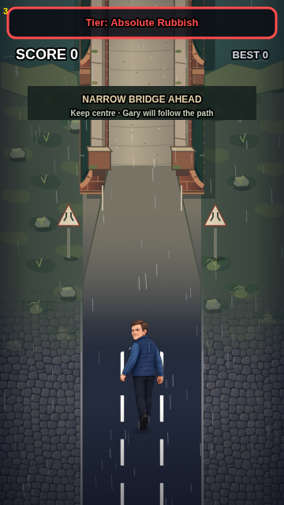
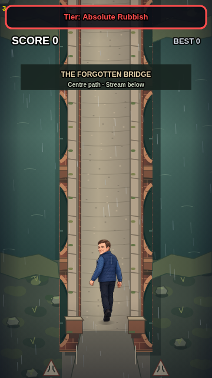
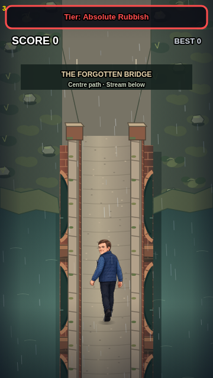
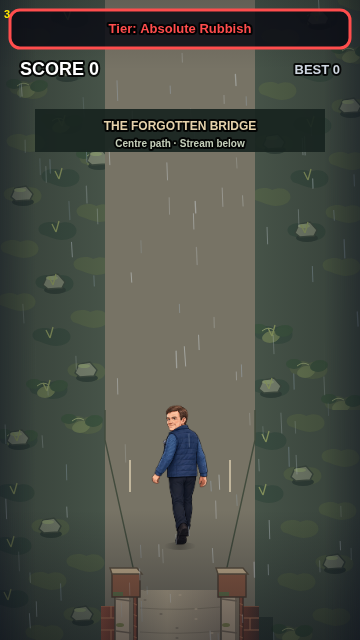

# The Forgotten Bridge

**22 October 2026 override:** The active `index.html` and latest `main` commit `688f09c4` supersede this document's historical status claims: `gary-difficulty-runtime.js` is the live-loaded engine, the bridge/wilderness modules are on `main`, painted bridge art is an unapproved debug candidate, and DRAFT01 wilderness graphics are USER-REJECTED. Do not treat an older 'not implemented' or 'unmerged' statement as current. See [conflicts](docs/camera/CONFLICT_REGISTER_2026-10-22.md). Public deployment and iPhone playback are unverified.

## Supplied artwork candidate — 20 October update

PR #5 now integrates the externally produced three-layer painted bridge as a **NOT APPROVED** Camera Lab review candidate in the active engine. Its own calibrated masks and independent water occlusion replace the earlier masks for this candidate only. The legacy renderer remains normal Play’s default. See [BRIDGE_ARTWORK_PIPELINE.md](BRIDGE_ARTWORK_PIPELINE.md) for exact registration, four inspected views, full crossing QA, source-art defects and physical-iPhone limits. PR #4 and PR #5 remain unmerged.

20 October 2026 — implemented in this checkout; deployment requires the PR to be merged separately. Revert this feature commit to roll back. Historical engines/installers are untouched.

## Artwork preparation on stacked PR #5

[Registered artwork pipeline](BRIDGE_ARTWORK_PIPELINE.md) adds opt-in Camera Lab blockouts, deeper supports and separate water occlusion, replaceable transparent templates and an exact artist specification. The original bridge below remains the default. Candidate projection and artwork are unapproved.

## Play and review

Serve the repository (`python3 -m http.server 8000`) and open [gary-bridge-preview.html](gary-bridge-preview.html). It embeds the **actual index.html and active difficulty engine**, without duplicated gameplay code. Approach / Enter / Halfway / Exit restart at exact world positions. Tap either half to steer; Pause/Resume, Replay and Freeze view work on touch. The full 360×640 camera scales to fit compact phones. Debug discoveries and best scores use separate save keys; preview crashes do not write normal difficulty telemetry.

Normal Play reaches the bridge only after the first reader dialogue, bench departure and fox completion. Both theft and spared/missed-roll outcomes are covered. The old missed-roll threshold now matches the engine's y=700 retirement boundary, avoiding a stuck fox event.

| Approaching | Entering |
| --- | --- |
|  |  |
| Halfway | Exiting towards wilderness |
|  |  |

These are actual Chromium Canvas captures at 360×640, with normal Gary artwork, HUD and storm. All four were opened and inspected. First-pass defects corrected: upright slot-shaped arches, hard entrance road seam, hidden parapet front faces, and cropped compact-phone framing. The final side arches follow the shallow side plane, with dark soffits, red-brick piers and short grounded shadows. Existing HUD/costume/art are preserved.

## Runtime contract

- `gary-bridge.js`: reusable state controller and separately callable water/terrain, lower masonry, deck and foreground-wall passes. Four immutable 360×1000 caches (about 5.5 MiB RGBA) are painted once at startup, reused across resets. No bridge canvases or brick geometry are built during play. Water has at most 26 moving ripple paths; terrain feathering uses at most eight 16-unit bands. Animation reads the fixed-step clock and freezes during pause.
- Fixed 360×640 camera; lanes remain x130/180/230. Deck x138..222, length620. Parallel edges, shallow side projection, no zoom or distance scaling. Existing scrolling distance registers all layers, signs, bank edges and the continuing wilderness verge.
- Warning starts with the near edge at y=-180. Road signs reinforce the banner. Centre guidance begins at y350; the existing eased lane controller completes before the entrance reaches Gary's y540 feet. Outward taps hold the centre while narrow. Normal controls return after the far edge and taper pass Gary.
- No hazard rows during approach/crossing/exit; activation requires cleared hazards. Pending rows cannot accumulate. Ordinary spawning resumes with the director's full approach gap after the crossing. No new collision objects, jump/slide mechanics, inventory, scoring rules or simulation frequency changes.
- `requestCollapse(roll)` is a **disabled future branch hook**, never called by the engine. It requires explicit opt-in, a ready `underwater-cave` biome, current crossing, and roll in [0,.01). Selection is once per run. There is no shipped biome, fall animation, route change or hidden chance in ordinary play. Tests exercise gating with a stub readiness provider.
- Wilderness here is the continuing path and procedural vegetation/rocks. A complete wilderness gameplay biome, cave and historical chapters remain planned.

## Verification and remaining art

`npm test` runs unchanged existing unit/asset/native integration/browser checks plus seven bridge tests. `tests/bridge-browser.cjs` captures the four positions and plays the real engine through touch, pause/resume, completion, replay and compact viewport fitting. Artifacts are written under ignored `test-results/bridge-chromium/`; the four review captures above are registered opaque QA images, never runtime sprites.

| ID / source | Display geometry | Status | Observed evidence / remaining correction | Next phone check |
| --- | --- | --- | --- | --- |
| Bridge / gary-bridge.js | 360×640 camera, 84-unit deck; 620-unit span | PASS for inspected browser geometry | Four captures inspected; raised masonry, dark side arches, top/front wall faces, water both sides, narrowing/widening | Check depth and Gary clearance while moving |
| Bridge progression / active engine | Existing 60 Hz simulation, x180 safe crossing | PASS in automated engine/browser tests | Both fox outcomes, guided lane, pause/reset, safe spawn release and collapse gating | Play natural story with audio in Safari |
| Illustration / procedural cache paint | Native gameplay scale | POLISH remains | Bespoke procedural art; simplified/repeated masonry, angular banks and small vegetation. Artist can refine bank silhouettes, brick wear and painted foliage in the same caches | Review on bright/dim phone screens |
| Physical iPhone Safari / performance | Device DPR and refresh rate | UNVERIFIED-ON-DEVICE | Chromium mobile emulation is not device FPS, Safari/audio or illustration sign-off | Review first entry, rotate/freeze, rain and replay on iPhone |

No external professional hand-painted bridge artwork was available. The procedural version is reviewable and playable; illustration approval remains a visual decision. WebKit and physical iPhone execution are not implied by the Chromium results.
