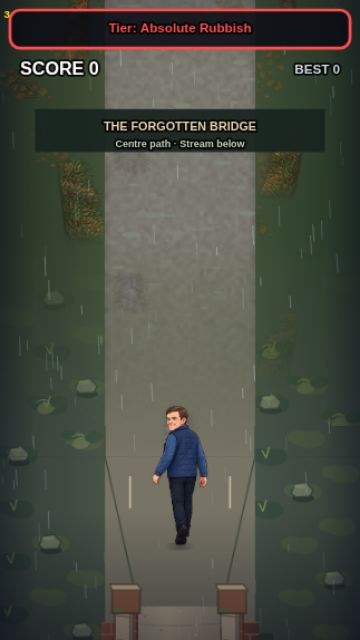
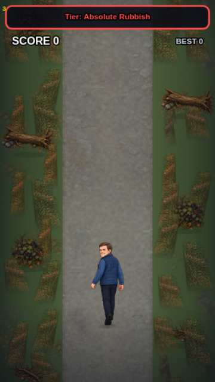
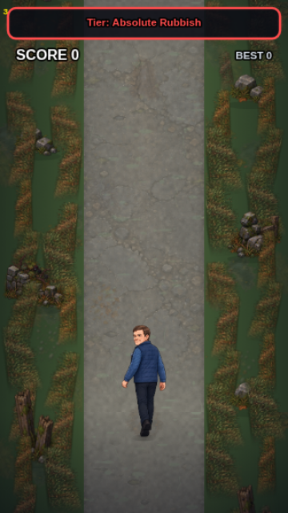
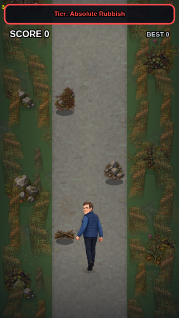
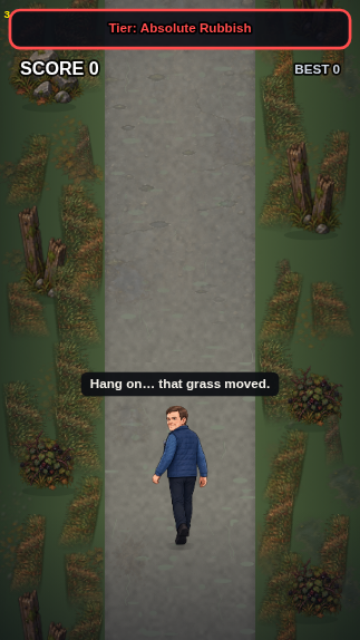
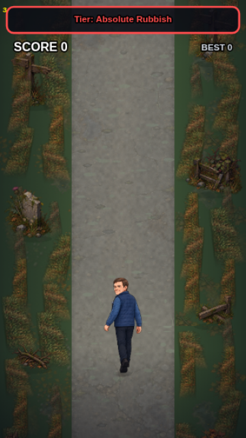

# The Other Side — first wilderness

## Status and review

CODE-OBSERVED / TESTED: first playable wilderness follows the stranger, completed fox and Forgotten Bridge on `feat/visual-camera-calibration` (PR #5, stacked on #4). No merge or deployment. Supplied DRAFT01 pixels only; no new illustration. Bridge production artwork and raised projection remain unapproved and review-only. Normal Play retains its existing bridge renderer and disabled collapse.

Open `gary-wilderness-preview.html` from a local HTTP server for the real engine on an iPhone-sized screen. Six presets, Play/Freeze, Pause/Resume and tap steering use the existing isolated bridge preview session; discoveries, best score and difficulty telemetry cannot overwrite real saves. Presets are debug fixtures, not screenshots of a manually completed run. The story integration regression independently reaches wilderness through reader → fox → bridge.

| Bridge exit | Beautiful reveal | Dense section |
| --- | --- | --- |
|  |  |  |

| Natural hazards | Rustling grass | Mystery landmarks |
| --- | --- | --- |
|  |  |  |

These are inspected, actual-engine 360×640 Chromium exports, independent of CSS size/DPR. Rustle and obstacle fixtures make the effect and all three hazard silhouettes immediately reproducible. Browser suites regenerate the six captures in `test-results/wilderness-{chromium,webkit}/`.

## Registration, extraction and replacement

The supplied archive was found on `origin/main` and copied alone to this feature branch; main was not merged. `GaryEats_Wilderness_Asset_Pack_DRAFT01.zip` SHA-256: `30d4485b3513b8e5cf1a0726b638a2bdc6956736140aae76b53d82316bb97d18`.

- Original instructions: `art/wilderness/manifest.json`, `art/wilderness/README.txt`.
- Measured source crop rectangles, output dimensions, alpha bounds, bottom-centre anchors and SHA-256 for **38 runtime images**: `art/wilderness/registration.json`. Rectangle convention: left/top inclusive, right/bottom exclusive, source pixels.
- Runtime paths, draw width/height, source dimensions, anchors and roles: `gary-wilderness-data.js`. Source dimensions do not imply game units; every object has a constant world draw size and uniform source aspect. Road surfaces explicitly fill their registered150×512 ground-cache footprint. No distance scaling or vanishing point.
- Registry: `asset-quality-manifest.json`, including the six review captures. Replace an image at its canonical `art/wilderness/...png` path, retain registration, or update data + measured report + registry together. Rerun pixel/registration tests and engine captures. The supplied manifest describes the archive; the registration report describes the actual extracted runtime files.
- Reproducible extraction: `python tools/prepare-wilderness-assets.py`, requiring Pillow, numpy and scipy (authoring only). It never synthesises pixels. The grass QA/registration documents in the archive were inspected; six individual 256×512 sprites are used directly.

Atlas audit: declared cells are not reliable. In particular the large log crosses a nominal 512px cell. Props, hazards and ruins are isolated by measured major alpha components, assigning alpha≥64 pixels to their nearest object; low-alpha generated haze is discarded, RGB is preserved and each object gets eight transparent pixels of padding. Decals use individually measured safe crop regions, not the proposed grid. The report records each crop and the tests validate the resulting bytes and transparency. Individual grass PNGs retain supplied pixels; the runtime atlas adds a small alpha-only foot/edge feather to soften their ground cutouts. Road variants use clean interior strips; all four surfaces appear as cached variants with a restrained blend over the base surface.

Excluded: concept/mockup/QA reference boards, redundant grass atlas and narrow outer gravel strips from the road atlas. No canonical object had to be discarded. The large log is **roadside decoration**, never a full-width road hazard. Puddles and muddy ruts, including assets named “hazard” in the source pack, are **non-damaging decals**.

## World and layers

The camera contract is unchanged: 360×640, road x105–255, lanes x130/180/230, existing Gary scale/foot anchor/movement. Bridge deck x138–222, 84×620, with its original 150-unit entrance and exit. Terrain origin is `bridge.anchor + 620 + 150`; progress is Gary's foot distance beyond that plane (`distance - origin - 546`). Normal three-lane navigation resumes through existing bridge guidance.

| Stage | Progress from full-width exit | Behaviour |
| --- | --- | --- |
| A: exit | 0–1499 | Sparse verge growth; 900-unit hazard-free breathing space |
| B: reveal | 1500–3999 | Richer vegetation, timber and rocks; rain eases and light warms |
| C: deep | 4000–8499 | Dense double verge grass, more props and occasional ruins |
| D: mystery | 8500 onward | More ancient markers, broken structures; unexplained independent rustling |

Rain target eases smoothly from 1 to .04 across progress300–3100; night tint eases from 1 to .14 across600–3800. No camera animation, interruption or movement freeze. Distribution is a pure seed/world-slot hash with bounded offscreen culling, grass variation, staggered placement and subpixel wind. Terrain is registered in fixed512-unit strips; the first220 units feather the new banks and paving over the old environment rather than cutting horizontally. Objects occupy64-unit slots, drawn far-to-near.

Passes: existing street/bridge terrain when visible → independent wilderness verge floor → road surface → wet decals → rear grass/props/ruins → existing pooled pickups/hazards and Gary → foreground verge objects → existing bridge parapets when visible → weather/HUD. Decorations clip outside x103–257, leaving the entire150-unit road clear; obstacles alone enter lanes. Existing contact shadows ground hazards; roadside props have separate elliptical shadows. No grass, rocks, ruins or hazards are baked into road surfaces. Bridge masonry, deck, foreground PNGs and water masking are untouched.

## Gameplay and encounters

Existing difficulty director remains the sole row generator. Once wilderness starts, wide street barriers are disabled. After900 units, ordinary hazards are substituted with `fallen_branch_small_01`, `boulder_cluster_hazard_01` and `thorn_bramble_hazard_01`. They keep the existing one-lane medium-hazard contact/collision geometry; the director still proves reachable lanes and reaction budgets. No jump, slide or three-lane blockage. Natural collisions use the existing medium crash scene; restart resets the biome without discarding caches or saved discoveries. Existing food selection, roast, points and catalogue are retained.

`gary-wilderness-encounters.js` is a reusable, rendering-independent active-time scheduler. Defaults: eligible after1800 units; initial10s delay; .35 chance per8s check;22s cooldown after completion. Own seeded RNG, no global random consumption. It first reserves a quiet corridor, waits for hazards to clear, then samples one outcome:60% nothing,28% approved custard cream in centre lane,12% subtle caption. Rustle1.4s, recovery2.4s; failed pooled pickup allocation retries without resampling or double-awarding. Food uses the existing pool, collection, denominator and discovery path. It never runs during dialogue, fox, bridge transition, pause or crashes; no new animal art or storyline exposition.

## Performance and validation

All images decode and caches warm before Play. Retained caches: one1024×1024 sprite atlas, four150×512 road surfaces and four360×512 verge floors and two feathered entrance tiles: **8.98MiB** RGBA. Three temporary150×512 surface compositing canvases are startup-only. Source decoded pixels total **23.74MiB**; sources plus retained caches approximately **32.72MiB**, excluding existing assets, browser/GPU copies and transient decode memory. No runtime canvas creation, sprite slicing, image decode or pixel processing at transition/encounter time. The existing60Hz fixed-step simulation and pools are unchanged. Hidden street and bridge rendering is skipped once wilderness covers the viewport.

`npm test` runs the existing unit, full asset, integration and browser suites, plus eight focused wilderness tests and Chromium/WebKit wilderness browser coverage. New checks cover source/hash/crops, registration, deterministic rendering and reset/cache reuse, lane-clear scenery, progression, real story order,40s of natural hazard spawning, safe reaction intervals, all encounter outcomes, cooldowns, pool retry, pause, real food scoring/discovery, all three crash/restart paths and real-save isolation. Browser tests cover six captures, real scrolling/rustle, pause/resume, mobile preview layout, live frame pacing and zero frame canvas allocations.

Timing files: `docs/wilderness/performance-chromium.json` and, when available, `performance-webkit.json`. Same-engine reference is the pre-existing middle bridge scene versus dense wilderness, warmed synchronous render CPU on a headless cloud host. It is a scene-cost comparison, not a before/after FPS improvement or physical-iPhone claim. Local validation passed30 unit tests,39 integration tests, all80 registered image contracts and all five Chromium browser suites. Local WebKit is blocked by missing OS libraries; the unchanged Actions browser job installs those libraries and runs the complete suite in Chromium and WebKit. Final CI results and links are recorded in PR #5.

## Remaining visual / device work

VISUALLY INSPECTED: six engine compositions, road width and actor scale, hazard contrast, landmark anchors and independent foreground ordering. Supplied DRAFT01 grass is olive/brown, with broad triangular ground footprints; alpha feathering reduces but cannot remove the repeated wedge appearance. The pack does not deliver the lush green hand-painted reveal in the brief by itself. Sparse floor detail and occasional repeated props remain visible. These require revised approved artwork, not invented replacement pixels or collision changes. Some source arches/ruins imply a provisional raised projection; placement here does not approve that projection.

UNVERIFIED-ON-DEVICE: physical iPhone Safari sustained pacing, memory pressure, thermal behaviour, high-DPI detail, audio/lifecycle and touch feel. Cloud WebKit is a browser regression check, not device approval. Jump/slide, new wildlife art, later historical biomes and bridge collapse remain deferred. No bridge final-art promotion, merge or Pages deployment is included.
